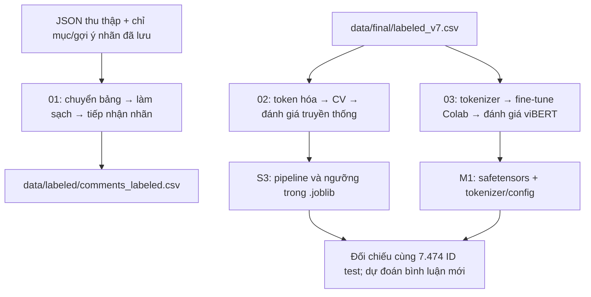

# Tổng quan project và luồng thực hiện

Project phân loại bình luận Facebook của sinh viên PTIT thành **ham** (bình
luận thông thường) và **spam** (nội dung rác/chào mời). Ba notebook đi từ dữ
liệu, gán nhãn đến mô hình truyền thống và viBERT; kết quả cuối dùng để đánh
giá phương pháp và dự đoán bình luận mới.

Sơ đồ mô tả luồng xây dựng/thực nghiệm; Notebook 03 mặc định review kết quả
và checkpoint đã train thay vì chạy lại fine-tune. Hai đầu vào CSV và v7 không
được tự thay thế cho nhau khi chạy notebook.

## 1. Đọc project theo thứ tự nào?

| Tài liệu | Dùng khi nào? |
|---|---|
| [README gốc](../../README.md) | Cài môi trường, chọn kernel, chạy từng lệnh hoặc từng notebook |
| Tài liệu này | Hiểu toàn bộ luồng, đầu vào/đầu ra và kết quả |
| [Danh mục pipeline](../../pipeline/README.md) | Vai trò từng module; mở README con để đọc từng file/hàm |
| [Lộ trình trình bày](../presentation/LO_TRINH_TRINH_BAY.md) | Mục notebook nào mở đoạn code nào |
| [Phân công học](../team/TEAM_ASSIGNMENTS.md) | Từng thành viên cần hiểu lý thuyết, code và output nào |

## 2. Các thư mục và file ở gốc

| Thư mục/file | Vai trò |
|---|---|
| `notebooks/` | 01: thu thập/chuẩn bị nhãn; 02: thực nghiệm truyền thống; 03: viBERT |
| `pipeline/` | Mã xử lý, huấn luyện, suy luận và hiển thị dùng chung; mỗi thư mục con có README |
| `external/facebook_scraper/` | Mã nền crawler được bàn giao, dựa trên repo tham khảo. `group_post_scraper_v2.py` lấy bài; `main.py`/`comment_scraper.py` lấy comment/reply; các module ảnh, proxy, GUI hỗ trợ các nhánh khác, không đều được dùng trong notebook |
| `data/` | CSV làm việc và đầu vào thực nghiệm; không đưa Git |
| `artifacts/` | Mô hình đã học, dự đoán theo ID, lịch sử và hình; không đưa Git |
| `results/` | Bảng kết quả và bằng chứng kiểm tra nhỏ để theo dõi trong Git |
| `tests/` | Kiểm thử hàm/module bằng dữ liệu nhỏ; không phải dữ liệu huấn luyện thực nghiệm |
| `scripts/run_notebook.py` | Điều phối cả notebook trong kernel mới, dùng đúng Python gọi lệnh |
| `scripts/check_environment.py` | Kiểm Python và phiên bản đã pin của môi trường truyền thống |
| `scripts/prepare_colab_bundle.py` | Gói code, v7 và dự đoán S3 để chuyển nội bộ lên Colab; không đóng gói phiên/API |
| `tools/dataset_versions/` | `merge_labeled_data.py` tạo CSV tổng hợp riêng; `audit_source.py` đối soát nguồn khi cần. Không tham gia fit mô hình |
| `requirements/` | `notebook.txt`: 01/02; `collection.txt`/`annotation.txt`: dịch vụ; `dev.txt`: test; `modern.txt`: review local; `modern-colab.txt`: train GPU |
| `docs/` | Hướng dẫn, phân công, nguồn tham khảo, ảnh đề và tài liệu lịch sử |
| `.cache/collection/` | JSON thu thập, chỉ mục ID và phản hồi gán nhãn đã lưu cho Notebook 01 |
| `.work/` | Kernel/runtime, notebook thực thi, file kiểm thử/gói chuyển tạm; không phải nơi lưu model cuối |
| `.venv/`, `.venv-modern/` | Hai môi trường Python riêng, tránh xung đột dependency |
| `.gitignore`, `pytest.ini` | Loại file local khỏi Git; cấu hình tìm test/import |

`__init__.py` tạo package, không phải bước chạy. README trong từng package mô
tả thứ tự gọi hàm. Không cần chạy lần lượt tất cả file `.py` trong một folder.

## 3. Notebook 01 — Thu thập và chuẩn bị dữ liệu

Các đường dẫn module trong bảng tính từ `pipeline/`.

| Mục | File/hàm đi qua | Công việc và đầu ra |
|---|---|---|
| 1. Cấu hình | `scripts/check_environment.py` ở gốc repo | Kiểm `.venv`, đặt nguồn `.cache/collection/` và đầu ra `data/` |
| 2. Thu thập | `collect/scrape_ptit_groups.py`: `run_scraper`, `on_batch`, `SingleFileWriter.save_records`; mã nền `external/facebook_scraper/` ở gốc repo | Giải thích nhóm → bài → comment/reply → JSON. Cell đọc JSON đã lưu, hiện group/link/bình luận thực tế |
| 3. Chuẩn hóa cấu trúc | `collect/json_to_csv.py`: `flatten_posts` | Comment/reply thành từng dòng, bỏ text rỗng → `data/intermediate/comments.csv` |
| 4. Làm sạch/định danh | `prepare/clean_for_labeling.py`: `clean_facebook_comments`; `label/cached_annotations.py`: `attach_annotation_ids` | Giữ `text`, tạo `cleaned_text`, khử trùng/lọc, nối ID đúng → `comments_cleaned.csv` |
| 5. Nhãn | `label/ai_assisted_spam_ham.py`: mã tạo gợi ý; `auto_accept_labels.py`: CLI được cell gọi | Áp ngưỡng confidence 0,75 → `annotation_predictions.json`, `annotation_review.csv` |
| 6. Xuất dữ liệu | Cell lọc `official_label`, đổi tên cột và `to_csv` | Chỉ giữ ham/spam đủ điều kiện → `data/labeled/comments_labeled.csv`; ghi `data/collection_manifest.json` |

Chạy Notebook 01 có thực hiện chuyển bảng, làm sạch, nối gợi ý, tiếp nhận nhãn
và ghi lại CSV. **Không gọi lại Facebook/LLM/Argilla.** Khối trích mã crawler/AI
giải thích cách thu thập/gán nhãn qua dịch vụ. Nếu cần dữ liệu mới, chạy các CLI
có phiên/API theo README; số mẫu mới phụ thuộc nguồn hiện tại.

Kết quả hiện tại: **5 nhóm, 2.170 bài → 13.833 comment/reply → 13.704 text không
rỗng → 10.974 mẫu sau làm sạch → 6.571 gợi ý khớp → 6.289 mẫu được tiếp nhận**
(5.190 ham, 1.099 spam). CSV có ID, metadata bài/nhóm, `text`, `cleaned_text`,
nhãn và confidence. Không tự gán ham cho mẫu thiếu gợi ý/chưa đạt ngưỡng.

Tool `merge_labeled_data.py` là tiện ích ngoài notebook: đọc CSV có sẵn và CSV
vừa xuất, ghi `data/final/comments_merged.csv`. File này không ghi đè v7 và
không phải bước bắt buộc trước mỗi lần chạy Notebook 02.

## 4. Notebook 02 — Thực nghiệm truyền thống và ứng dụng

Đầu vào cố định là **`data/final/labeled_v7.csv`**, 38.233 bình luận: 32.907 ham
(86,07%), 5.326 spam (13,93%). Notebook không tự đổi đầu vào khi chạy Notebook 01.

| Mục | Mã nguồn trong `pipeline/` | Công việc/đầu ra |
|---|---|---|
| 1–2. Môi trường/khảo sát | Cell notebook và checker ở `scripts/` | Kiểm phiên bản, ID/nhãn, hiện bình luận thật, tỷ lệ và độ dài |
| 3. Tiền xử lý | `prepare/preprocess_for_model.py`: `preprocess` | Chuẩn hóa, xử lý tên/URL/điện thoại/emoji, underthesea; lưu toàn bộ hai cột giữ/bỏ từ dừng vào `data/processed/v7_preprocessed.csv` và đọc lại |
| 4. Thiết kế | `modeling/training_utils.py`: `norm_key`, `bucket`, `grouped_folds` | Nhóm văn bản, chia 30.759 train/7.474 test; CV năm fold trên train |
| 5. Huấn luyện | `modeling/experiments.py`: `make_pipe`, `fit_experiment` | Đối chiếu từ dừng bằng CV; chọn giữ từ dừng, so sánh B1–B4: BoW/TF-IDF × NB/SVM |
| 5.1. Mất cân bằng | `fit_experiment`, `undersampled_search`, `tune_svm_threshold` | Cố định TF-IDF+SVM; B4 đối chứng, S1 balanced, S2 giảm ham 2:1, S3 chỉnh ngưỡng OOF |
| 5.2. viBERT | Trích `modern/train.py`: `load_pretrained` | Giới thiệu nhánh hiện đại; không train viBERT trong Notebook 02 |
| 6–6.3. Đánh giá | `experiments.evaluate`, `boot_ci` và cell vẽ hình | Test, FP/FN, ma trận, PR/AP và bootstrap F1 cho bảy ứng viên |
| 6.4. Đối chiếu M1 | Đọc `results/modern/` ở gốc repo | Bảng test viBERT–S3 đã xác nhận, không gọi fine-tune |
| 7. Phân tích | Cell hệ số/lỗi | Ví dụ của **cấu hình được chọn bằng CV**, giữ ID/text/nhãn/score |
| 8–9. Lưu/demo/nhận xét | `joblib.dump/load`; `inference/predict.py`: `predict_spam` | Lưu S3, nạp lại kiểm tra và phân loại bình luận mới bằng cùng ngưỡng |

**CV và test:** mỗi lượt CV học trên bốn fold train, đo fold validation còn
lại; trung bình F1 spam dùng chọn cấu hình. Sau đó fit toàn bộ train và đo test
để báo cáo. Từ vựng, IDF và lấy mẫu chỉ học/thực hiện trong
phần train được phép. CV phục vụ lựa chọn, chưa phải nested CV độc lập.

**Mất cân bằng:** ba chiến lược được thử riêng. Balanced tăng trọng số lỗi của
spam; under-sampling giảm ham chỉ trong train; ngưỡng thay đổi quyết định,
không thay đổi số mẫu. B4 xuất hiện ở cả bảng bốn tổ hợp và bảng bốn chiến lược
nhưng chỉ là một ứng viên: **4 + 3 = 7**, không phải tám mô hình khác nhau.

S3 được chọn theo CV F1 **0,7876**, giữ từ dừng, C=0,3, n-gram=(1,2), ngưỡng
**−0,1776**; không trọng số và không lấy mẫu lại. Ngưỡng âm là decision score
SVM, không phải xác suất âm. Test F1 **0,7552**, Precision **0,8374**, Recall
**0,6877**. S3 chỉ nhỉnh hơn S2 (F1 0,7542); chưa đủ kết luận vượt trội về
thống kê. Không có mô hình truyền thống đứng đầu mọi chỉ số.

## 5. Notebook 03 — viBERT

| Mục | File/hàm trong `pipeline/modern/` | Công việc/đầu ra |
|---|---|---|
| 1–2. Môi trường/dữ liệu | `data.py`: `prepare_data`, `split_summary` | `.venv-modern` local hoặc Colab GPU; giữ test của 02. Trong train: 24.815 fit, 5.944 validation |
| 3. Tokenization | `normalize_text`, tokenizer cased | Text gốc → NFC/HTML/khoảng trắng → WordPiece, ID/mask/padding; giữ case/từ dừng; max length 128 |
| 4. Xây dựng | `train.py`: `load_pretrained` | Nạp encoder `FPTAI/vibert-base-cased`, thêm head hai lớp; fine-tune encoder và head |
| 5. Huấn luyện | `ClassificationTrainer`, `fit_variant`, `select`, `finalize` | So hai loss bằng validation, chọn loss/epoch; khởi tạo lại pretrained và fit toàn bộ train |
| 6. Đánh giá | `compare_with_svm`, `draw_figures` | Cùng 7.474 ID/nhãn test với S3; bảng metrics, ma trận và PR |
| 7. Phân tích | Cell đọc `test_predictions.csv` | FP/FN của **M1**, text gốc và xác suất spam |
| 8–9. Lưu/demo/nhận xét | `save_pretrained`; `predict.py`: `VibertPredictor` | Nạp trọng số/tokenizer, kiểm tra nạp lại và dự đoán bình luận mới |

**`MODE="train"`** gọi fine-tune trên GPU; **`MODE="review"`** đọc lịch sử/kết
quả và chạy suy luận từ model đã lưu. Notebook mặc định review. Không gọi việc
đọc bảng là huấn luyện lại.

Đã train trên Colab **A100 80 GB**. Loss thường/epoch 3 được validation chọn
(F1 0,82048 so với 0,81916 của balanced). Sau đó fit lại 30.759 train và đo test.
Ngưỡng xác suất spam cố định 0,5. Validation F1 một fold của viBERT không tương
đương CV F1 năm fold của SVM; bảng đối chiếu chỉ dùng test.

`##`, `[CLS]`, `[SEP]` là ký hiệu WordPiece/BERT. `[UNK]` cho biết phần nội dung
không biểu diễn được bằng từ vựng hiện có; tên nước ngoài có thể có nhiều
`[UNK]`. Đây không phải lỗi font. Xem [cách đọc token](DOC_TOKEN_VA_KET_QUA.md).

## 6. Kết quả cuối và giới hạn

| Cấu hình | Accuracy | Precision spam | Recall spam | F1 spam | AP | FP / FN |
|---|---:|---:|---:|---:|---:|---|
| S3 — TF-IDF+SVM chỉnh ngưỡng | 0,9433 | 0,8374 | 0,6877 | 0,7552 | 0,8117 | 127 / 297 |
| M1 — viBERT | **0,9635** | **0,8942** | **0,8086** | **0,8493** | **0,9108** | **91 / 182** |

M1 bắt thêm 115 spam và giảm 36 ham nhận nhầm trên cùng test. Kết quả không chỉ
là Accuracy cao do lớp ham nhiều. Chưa bảo đảm đúng với mọi bình luận hoặc
Facebook ở thời điểm/nhóm khác.

Giới hạn: chất lượng nhãn hiện có; bình luận gần trùng/phụ thuộc ngữ cảnh;
tên riêng/teencode/ký tự ngoài từ vựng; câu quá ngắn/chỉ dấu câu; chưa đánh giá
nhiều seed hoặc test độc lập theo thời gian/nhóm. Xác suất viBERT có thể cao dù
sai, chưa calibration. Chia nhóm văn bản hạn chế trùng theo khóa, không chứng
minh loại hết mọi dạng rò rỉ hoặc ngữ cảnh chung.

## 7. File kết quả nằm ở đâu?

| Đường dẫn | Nội dung và cách dùng |
|---|---|
| `data/intermediate/`, `data/labeled/` | Bảng trung gian và CSV cuối Notebook 01 |
| `data/final/labeled_v7.csv` | Đầu vào cố định của 02/03 |
| `data/processed/v7_preprocessed.csv` | Toàn bộ v7 kèm hai chuỗi token truyền thống |
| `data/processed/vibert_split.csv` | ID và vai trò tập dữ liệu của viBERT |
| `artifacts/spamham/` | S3 `.joblib` và dự đoán theo ID của S3; metrics/CV/bootstrap của bảy cấu hình, manifest và hình |
| `artifacts/modern/vibert/` | `model/`, lịch sử hai loss/final train, split, metrics, dự đoán theo ID, hình và trạng thái |
| `results/verified_run/` | Bằng chứng chạy/kiểm thử truyền thống; xem phạm vi/thời điểm từng JSON |
| `results/modern/` | Bảng so sánh/kiểm tra viBERT; không chứa trọng số |
| `results/source_audit/`, `results/history/` | Hồ sơ nguồn và bằng chứng cũ; không phải đầu vào train |

`.py` chứa cách xây dựng; đối tượng sau `.fit()` chứa trạng thái đã học;
`.joblib` (S3) hoặc `model.safetensors` kèm tokenizer/config (M1) lưu trạng thái
đó để dùng lại. Không tải viBERT bằng `joblib.load()`.

`data/`, `artifacts/`, môi trường/cache không được push Git. Máy thành viên cần
được cung cấp thêm đầu vào/model đúng đường dẫn. Xem README để chạy offline
hoặc thu thập/gán nhãn/huấn luyện lại qua dịch vụ.

## 8. Đối chiếu đề bài

Theo [ảnh đề](../assignment/de_bai.png): đã có nguồn bình luận PTIT và nhãn
spam/ham; làm sạch/tách từ và khảo sát từ dừng; hai biểu diễn (BoW, TF-IDF);
NB/SVM, chia train/test; Accuracy/Precision/Recall/F1, confusion matrix
và so sánh phương pháp; viBERT cho phần mô hình hiện đại bổ sung.

CV, bootstrap, PR/AP và các chiến lược cân bằng/ngưỡng là phần tăng chất lượng
thực nghiệm, đề không liệt kê bắt buộc từng kỹ thuật này. Trình bày rõ mục
đích và giới hạn của chúng.

**Code và thực nghiệm đã đáp ứng các đầu mục kỹ thuật; báo cáo học phần chưa
viết.** Cần hoàn thiện báo cáo và hình thức bài nộp trước khi chốt toàn bộ môn học.

## 9. Rà soát bản hiện tại

Lượt rà soát ngày 05–06/11/2026 chạy lại **01 (6 cell code), 02 (19 cell code)
và 03 review (9 cell code)**, không có lỗi trong cell. 01 hoàn tất 3,80 giây,
02 khoảng 613,62 giây, 03 review 12,95 giây trên máy hiện tại; thời gian không
phải chỉ số chất lượng mô hình.

- Cả bảy dòng chỉ số/tham số truyền thống khớp lần trước, bỏ qua thời gian;
  CSV có nhãn, CSV token và 7.474 dự đoán S3 giữ nguyên.
- Tính lại metrics viBERT từ toàn bộ dự đoán test cho đúng bảng đã báo cáo;
  nạp lại CPU trên 64 mẫu không khác nhãn so GPU, suy luận lặp 16 mẫu giữ điểm.
- Bộ kiểm thử chính: 60 đạt, một test torch bỏ qua trong `.venv`; chạy riêng
  môi trường modern có 4/4 đạt. Một cảnh báo deprecation của Argilla/Pydantic.
- Các bước offline và ví dụ suy luận trong README đã chạy thử. Link Markdown
  hiện hành, cú pháp Python và UTF-8 được kiểm tra. `text`/`cleaned_text` trong
  v7 và CSV Notebook 01 không có ký tự thay thế Unicode U+FFFD.

Windows vẫn có thông báo `joblib resource_tracker.KeyError` lúc dọn kernel 02;
cell tính toán và kiểm file/model hoàn tất. Chưa đổi dependency để tránh ảnh
hưởng cấu hình đã kiểm chứng. Không có lần cào Facebook/gọi API nhãn hoặc train
GPU mới trong lượt rà soát này. Bằng chứng:
`results/verified_run/final_review.json`, `documentation_commands.json` và
`results/modern/final_review_reload.json`.
